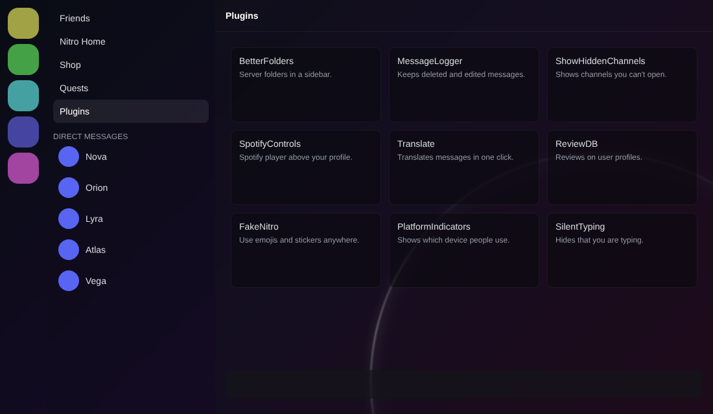
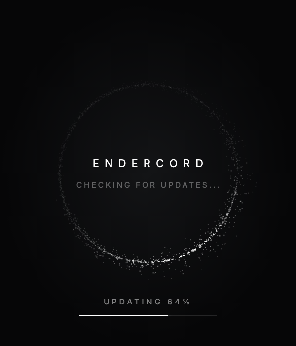
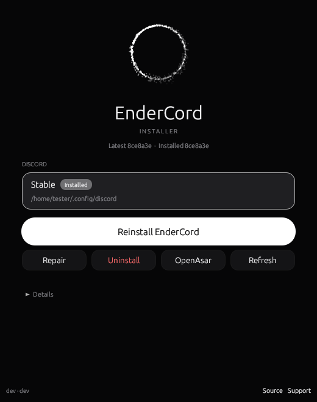

<p align="center">
  
</p>

<p align="center">
  <a href="https://github.com/EnderMythex/EndercordInstaller/releases/latest"></a>
  <a href="https://github.com/EnderMythex/Endercord/commits/main"></a>
  <a href="LICENSE"></a>
</p>

<p align="center">
  A refined Discord client mod with a translucent black theme, 300+ plugins,<br>
  and plugins you can write yourself without rebuilding anything.
</p>

<p align="center">
  <a href="#install"><b>Install</b></a> &nbsp;·&nbsp;
  <a href="#features"><b>Features</b></a> &nbsp;·&nbsp;
  <a href="#make-your-own-plugins"><b>Make plugins</b></a> &nbsp;·&nbsp;
  <a href="#build-from-source"><b>Build from source</b></a>
</p>

<br>

## Features

<table>
  <tr>
    <td width="62%"></td>
    <td width="38%"></td>
  </tr>
  <tr>
    <td align="center"><sub>Translucent theme preview, here with window translucency on</sub></td>
    <td align="center"><sub>Startup screen while an update downloads</sub></td>
  </tr>
</table>

- **Translucent black theme.** Discord's panels sit on a deep black background with the EnderCord ring glowing in the corner. Opacity is adjustable, and window translucency shows your desktop through Discord (frosted glass on Windows).
- **Animated startup screen.** A particle ring replaces Discord's loading logo, and EnderCord updates download right there with a progress bar, before Discord even opens.
- **Plugins page.** A Plugins entry sits next to Friends and Quests and opens a full page with your plugins, your own plugins and your themes.
- **Plugins without rebuilding.** Drop a JavaScript file in a folder, reload Discord, done. Works with the installer too. [How it works](#make-your-own-plugins)
- **Performance tab.** Live memory and CPU per Discord process, a one click Light Mode, and hibernation that frees memory while Discord sits in the background, with notifications and calls still coming through.
- **Stays put.** EnderCord re-applies itself when Discord updates, and restarts gracefully so you stay logged in.
- **300+ plugins** from [Vencord](https://github.com/Vendicated/Vencord) and [Equicord](https://github.com/Equicord/Equicord), plus the [PawsomeVencord](https://github.com/enzomtpYT/PawsomeVencord) extras.

<br>

## Install

<table>
  <tr>
    <td width="58%" valign="top">

Download the [**EnderCord Installer**](https://github.com/EnderMythex/EndercordInstaller), pick your Discord, click **Install**. It closes Discord gently, patches it and starts it again.

| | Download |
| --- | --- |
| **Windows** | [x64](https://github.com/EnderMythex/EndercordInstaller/releases/latest/download/EndercordInstaller.exe) · [ARM64](https://github.com/EnderMythex/EndercordInstaller/releases/latest/download/EndercordInstaller-arm64.exe) |
| **macOS** | [Universal](https://github.com/EnderMythex/EndercordInstaller/releases/latest/download/EndercordInstaller-macos.zip) |
| **Linux** | [x64](https://github.com/EnderMythex/EndercordInstaller/releases/latest/download/EndercordInstaller-linux) · [ARM64](https://github.com/EnderMythex/EndercordInstaller/releases/latest/download/EndercordInstaller-linux-arm64) |

Prefer a terminal? On Linux:

```sh
sh -c "$(curl -sS https://raw.githubusercontent.com/EnderMythex/EndercordInstaller/main/install.sh)"
```

On Windows, from PowerShell:

```powershell
iwr -useb https://raw.githubusercontent.com/EnderMythex/EndercordInstaller/main/install.ps1 | iex
```

  </td>
    <td width="42%" valign="top"></td>
  </tr>
</table>

After that, EnderCord keeps itself up to date: new builds download on Discord's startup screen.

<br>

## Make your own plugins

Open **Settings › Plugins & Themes › My Plugins**, or the **Plugins** page next to Quests.

### Quick plugins, no rebuild

Type a name and click **Create**. A JavaScript file appears in your plugins folder (`%APPDATA%\Equicord\plugins` on Windows, `~/.config/Equicord/plugins` on Linux). Edit it in any editor, then press **Ctrl+R** in Discord.

```js
module.exports = definePlugin({
    name: "HelloWorld",
    description: "Says hello when Discord starts.",
    authors: [{ name: "You", id: 0n }],

    start() {
        EnderCord.Common.showToast({ text: "Hello from my plugin!", variant: "success" });
    }
});
```

Quick plugins get `definePlugin` and an `EnderCord` object with everything the built in plugins use: `Api` (settings, commands, notifications, context menus), `Common` (Discord's React, stores and components), `Webpack` (find Discord modules), `Util` and `Components`. They load before the other plugins start, so patches work too.

> Every file in that folder runs with full access to your Discord account. Only add plugins you wrote or trust.

### Compiled plugins

For bigger plugins, write TypeScript in `src/userplugins/<name>/index.tsx`. They are built together with EnderCord, so they need the source version below and a rebuild after each change (the **Rebuild and Restart** button does both).

<br>

## Build from source

You need [Git](https://git-scm.com/downloads), [Node.js LTS](https://nodejs.org) and pnpm (`npm i -g pnpm`). Don't use an admin or root terminal, it can break your Discord install.

```sh
git clone https://github.com/EnderMythex/Endercord
cd Endercord
pnpm install --frozen-lockfile
pnpm build
pnpm inject
```

`pnpm inject` points your Discord at this folder, so after any change, run `pnpm build` and restart Discord. For the browser extension, run `pnpm buildWeb` and load the zip from `dist`.

<details>
<summary><b>PawsomeVencord plugins included</b></summary>
<br>

Located in `src/pawsomeplugins/` and filterable with **Show PawsomeVencord** in the plugin list.

- **alwaysPing**: always ping users when replying.
- **bark**: a chat bar button to bark in chat.
- **betterClips**: more clip controls and options.
- **betterMicrophone** *(desktop)*: further customize your microphone.
- **betterScreenshare** *(desktop)*: custom screen share resolution and frame rate.
- **bigFileUpload**: upload large files through external hosts with `/fileupload` or the chat button.
- **customVcNarrator**: voice channel narrator with TikTok voices for joins, leaves and moves.
- **fakeDeafen**: appear deafened while still hearing the channel.
- **meow**: a chat bar button with random meows.
- **notifyUserChanges**: get notified when someone joins a voice channel or changes status.
- **philsPluginLibrary**: shared helpers for Phil's plugins.
- **serverProfilesToolbox**: copy, paste and reset buttons in the server profile editor.
- **VenPlugPlus**: extra plugin management tools.
- **webcamStartNotifier**: alerts when cameras turn on in your voice channel.

</details>

<br>

## Credits

EnderCord stands on the work of [Vendicated](https://github.com/Vendicated) and the [Vencord](https://github.com/Vendicated/Vencord) contributors, the [Equicord](https://github.com/Equicord) team, [enzomtp](https://github.com/enzomtpYT) and the [PawsomeVencord](https://github.com/enzomtpYT/PawsomeVencord) contributors, and [Suncord](https://github.com/verticalsync/Suncord) by verticalsync. Licensed under the [GPL 3.0](LICENSE).

## Disclaimer

Discord is a trademark of Discord Inc. and is only mentioned to describe what this project works with. EnderCord is not affiliated with or endorsed by Discord Inc., Vencord, Equicord or PawsomeVencord.

<details>
<summary>Client mods and Discord's Terms of Service</summary>
<br>

Client modifications are against Discord's Terms of Service. In practice Discord doesn't go after people using them, and there are no known bans for client mods alone, as long as you don't use plugins that abuse Discord. Still, if losing your account would be a disaster, don't use any client mod. And avoid posting screenshots showing EnderCord in servers that might ban you for it.

</details>
